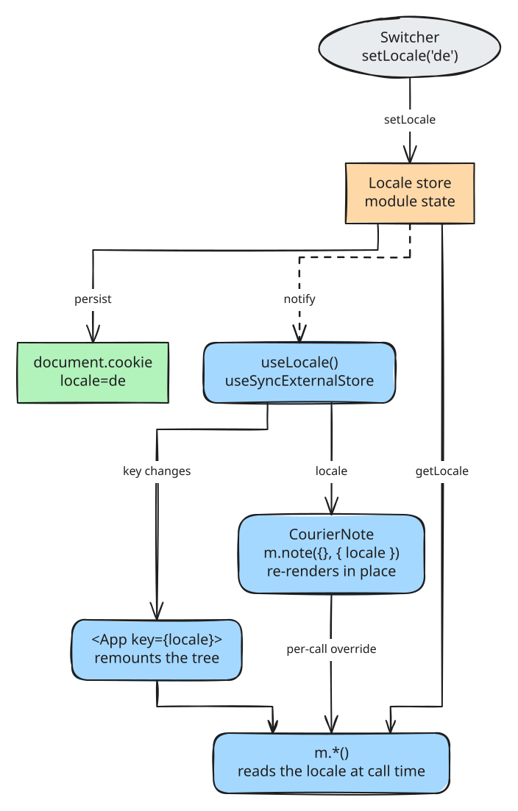

import { Aside } from '@astrojs/starlight/components'
import LanguageDemo from '../../../components/LanguageDemo.astro'

```ts title="src/loclizr/messages.d.ts"
export type AppLocale = 'de' | 'de-AT' | 'en'

export declare function getLocale(): AppLocale
export declare function setLocale(locale: AppLocale, options?: SetLocaleOptions): void
export declare function subscribe(listener: () => void): () => void
export { cookie, locales, sourceLocale } from './messages/_locale.js'
```

The barrel re-exports the one store in `loclizr`, narrowed to your locales. Outside React, use
`subscribe` directly; it returns its remover.

```tsx title="src/Switcher.tsx"
import { useLocale } from 'loclizr/react'
import * as m from './loclizr/messages'

const offered = [m.sourceLocale, ...m.locales.filter((tag) => tag !== m.sourceLocale)]

export function Switcher() {
  const locale = useLocale()
  const names = new Intl.DisplayNames([locale], { type: 'language' })
  return (
    <div className="switcher">
      {offered.map((tag) => (
        <button key={tag} type="button" aria-pressed={tag === locale} onClick={() => m.setLocale(tag)}>
          {names.of(tag) ?? tag}
        </button>
      ))}
    </div>
  )
}
```

`m.locales` is the frozen tuple `['de', 'de-AT', 'en']`; `m.sourceLocale` is `'en'`.

## How the locale is resolved

First match wins:

1. An active server request scope.
2. What `setLocale` stored.
3. With a DOM, detected once: the cookie, then `<html lang>`.
4. The source locale.

Matching is exact, then by cutting subtags (`de-CH` to `de`). An unknown tag, such as a cookie
edited to `sp`, renders the source locale, never `undefined`.

<Aside type="note">
Detection never reads `navigator.languages` or `localStorage`: a server sees neither, so hydration
would switch language. A client-rendered app can still follow the browser on a first visit, by its
own call.
</Aside>

### First visit in a client-rendered app

```tsx title="src/main.tsx"
import { localeFromHeaders } from 'loclizr'
import * as m from './loclizr/messages'

m.setLocale(
  localeFromHeaders(
    { cookie: document.cookie, acceptLanguage: navigator.languages.join(',') },
    { locales: m.locales, sourceLocale: m.sourceLocale, cookie: m.cookie },
  ) as m.AppLocale,
)
```

With no HTML rendered ahead of time, a first visit renders the source locale. This call, before the
first render, makes it follow the browser instead:

- A cookie under your `cookie` setting wins, read the same way the store and `loclizr/server` read it,
  so a visitor's pick holds on every later visit.
- Otherwise the first browser language in `m.locales`: exact tag (`de-AT`), then subtag truncation
  (`de-CH` to `de`). Otherwise the source locale.
- It returns a `string`; the cast is safe because the result is always one of `m.locales`.
- `setLocale` persists, so a later browser language change is not re-detected.
  `{ persist: false }` re-detects each visit until the visitor picks.

<Aside type="caution">
Client-rendered apps only. A page rendered on a server or prerendered at build time already carries
a locale in its HTML; negotiating again in the browser can pick another one, and the page then
hydrates in a language its HTML was not rendered in. [Astro](/guides/astro/#islands) covers
prerendered pages.
</Aside>

## Persistence

`setLocale('de')` writes the cookie (`cookie` in `loclizr.config.ts`, default `locale`), sets
`document.documentElement.lang`, then notifies subscribers. Where the page keeps cookies, the cookie
is the only persistence, since a server reads it back.

| Case | Effect |
| --- | --- |
| `{ persist: false }` | this page load only |
| `file://` page (Electron `loadFile`) or cookies blocked | this page load only; persist the choice yourself and call `setLocale` on startup. Outside production loclizr warns once: `loclizr: the locale cookie was not stored (file:// or blocked), so the choice ends on reload. Persist it and call setLocale() on startup.` |
| No `document`, React Native included | memory only, subscribers still notified |

Cookie attributes default to `path=/`, `max-age` one year, `SameSite=Lax`, no `Domain`, no
`Secure`. No `Domain` means host-scoped: `shop.example.com` and `help.example.com` do not share a
choice until the config sets `cookie: { name: 'locale', domain: 'example.com' }`
([Configuration](/reference/configuration/#cookie)). A visitor's earlier host-scoped cookie still
wins on each host until `setLocale` runs there and expires it.

`setLocale` never sets `dir`; for an RTL locale set it yourself from `useLocale()` or a `subscribe`
listener. Values inside a message are not isolated either: see
[Mixed-direction values](#mixed-direction-values).

After a reload following a persisted switch, the store reads the cookie and sets `<html lang>` to
match, so a client-only app sees no `<html lang>` warning; [React](/guides/react/) covers the
server-rendered case.

<Aside type="caution">
`setLocale` throws inside a server request scope:

```text
loclizr: setLocale() cannot run inside a request scope. Pass { locale } per call instead.
```

[Server rendering](/guides/server-rendering/) has the per-request shape.
</Aside>

## Mixed-direction values

Generated code inserts every placeholder value as it is, with no bidi isolation marks around it.
For `user.says`, `<b>{name}</b> כתב: {text}` in `he`:

```js title="src/loclizr/messages/user.js"
    case 'he':
      return [args.b([`${args.name}`]), ` כתב: ${args.text}`]
```

A user-supplied value that ends in a neutral character, such as the name `Ann!` inside that Hebrew
sentence, is reordered against the text around it and displays as `!Ann`. The reverse holds in a
left-to-right sentence: an Arabic name in `{name} - {count, number} reviews` makes the count display
before the name. Isolate the value yourself, one of two ways:

- Wrap the string in U+2068 and U+2069 (first strong isolate, pop directional isolate) before you
  pass it.
- Put the argument inside a tag in the catalog, `<iso>{name}</iso>`, and have the handler render a
  `<bdi>` element or wrap its text in U+2068 and U+2069.

```json title="locales/he.json"
{ "user": { "says_isolated": "<iso>{name}</iso> כתב: {text}" } }
```

```ts
const isolate = (s: string) => `\u2068${s}\u2069`
m.user_says_isolated({ iso: (chunks) => isolate(chunks.join('')), name: 'Ann!', text: 'ok' }, { locale: 'he' })
// ["⁨Ann!⁩"," כתב: ok"]
```

A bare `{name}` is typed `string | number`, so it cannot carry an element: the isolation goes through
a tag handler or a string.

## The per-call override

```ts
m.cart_items({ count: 3 }, { locale: 'de' })   // "3 Artikel in deinem Warenkorb"
```

A second-argument `{ locale }` beats the store for that call. The switcher below works this way, so the
page around it keeps its own language:

<LanguageDemo />

## What re-renders, and what does not

<figure class="diagram">



</figure>

Generated code imports nothing from React, so a component that only calls messages updates when its
parent next renders:

| Pattern | On a switch | Local state |
| --- | --- | --- |
| Key the root on the locale | subtree remounts, every string recomputed | lost below the key |
| Pass `{ locale }` per call | component re-renders in place | kept |

Combine them: key the root for the bulk, pass per call where state must survive.

### Key the root on the locale

```tsx title="src/main.tsx"
function Shop() {
  const locale = useLocale()
  const [cart, setCart] = useState(openingCart)
  return (
    <>
      <App key={locale} cart={cart} onChange={(patch) => setCart((current) => ({ ...current, ...patch }))} />
      <CourierNote />
    </>
  )
}
```

`cart` survives the remount because it lives above the key, in `Shop`; `App`'s own `useState`
would not.

### Pass the locale per call

```tsx title="src/CourierNote.tsx"
export function CourierNote() {
  const locale = useLocale()
  const [note, setNote] = useState('')
  return (
    <section className="note">
      <label htmlFor="note">{m.app_note({}, { locale })}</label>
      <textarea id="note" value={note} placeholder={m.app_notePlaceholder({}, { locale })} onChange={(event) => setNote(event.target.value)} />
      <p>{m.app_noteKeeps({}, { locale })}</p>
    </section>
  )
}
```

`CourierNote`, outside the key, re-renders in place and keeps the typed note. [React](/guides/react/)
has the React Compiler reason for this form.
